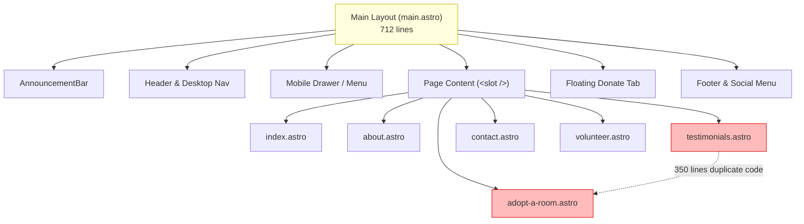
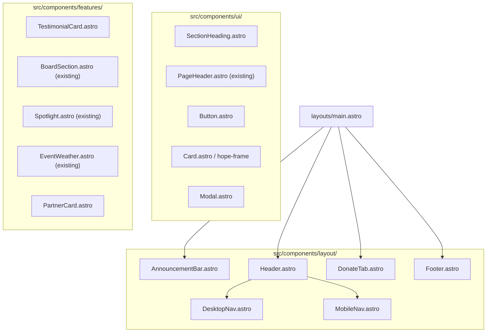

# Code Quality Review & Refactoring Roadmap: `site/src`

**Target Codebase:** `site/src` (Hope House Guthrie Marketing Portal)  
**Stack:** Astro 7.3.5, TailwindCSS 4.3.3, DaisyUI 5.7.46, Sharp, Vite  
**Date:** October 2026  
**Auditor:** Antigravity  

---

## 1. Executive Summary & Health Scorecard

A full architectural, stylistic, and code quality audit was performed on all components, pages, layouts, styles, and content configurations in `site/src`.

The site is built with Astro and modern tooling, with working image optimization pipelines via Sharp. However, the codebase exhibits significant technical debt stemming from rapid iteration, copy-pasted implementations across pages, underutilization of the DaisyUI design system, oversized monolithic components, and fragile client-side DOM manipulation.

### Code Health Scorecard

| Domain | Rating | Status | Summary |
| :--- | :---: | :---: | :--- |
| **Component Architecture & DRY** | **D+** | ⚠️ Needs Refactor | Massive duplication (~350 lines duplicated between `testimonials.astro` and `adopt-a-room.astro`); 712-line monolithic layout. |
| **TailwindCSS & DaisyUI Compliance** | **C** | ⚠️ Underutilized | DaisyUI is configured but virtually unused; forms and modals use ad-hoc styles instead of DaisyUI classes; hardcoded hex values in CSS. |
| **Client Script Performance & Fragility** | **C-** | ⚠️ Warning | Layout thrashing in header resize script; heavy SVG liquid filter loops; dead View Transition hooks. |
| **Accessibility & Semantics (a11y)** | **C+** | ⚠️ Needs Polish | Invalid section nesting in `about.astro`; broken `aria-describedby` reference in `contact.astro`; missing form element descriptions. |
| **SEO & Document Metadata** | **D** | ❌ Missing Standards | No Open Graph (`og:*`), Twitter Card, or canonical meta tags anywhere on the site. |
| **Dead Code & Incomplete Flows** | **D** | ❌ Action Required | Real forms submit to `TODO` stub success pages; 6 unused imports in `index.astro`; orphaned dialogs and disabled forms. |
| **TypeScript & Content Schemas** | **B-** | 🟡 Acceptable | Solid schema for `board` and `testimonials`, but dev tooling (`@astrojs/check`, `typescript`) is missing from `package.json`. |

---

## 2. High-Priority Defects & Critical Technical Debt

### 2.1. Critical Duplication: Testimonial & Liquid SVG Engine (~350 Lines Duplicated)
* **Locations:** [`site/src/pages/testimonials.astro#L24-L226`](file:///home/super/Projects/HopeHouseSite/site/src/pages/testimonials.astro#L24-L226) and [`site/src/pages/adopt-a-room.astro#L188-L338`](file:///home/super/Projects/HopeHouseSite/site/src/pages/adopt-a-room.astro#L188-L338), [`#L568-L746`](file:///home/super/Projects/HopeHouseSite/site/src/pages/adopt-a-room.astro#L568-L746)
* **The Issue:** The entire card template (markup, SVG `<filter>` with `<feTurbulence>` and `<feDisplacementMap>`, before/after photo layers, badges, quotes) along with an identical 180-line `requestAnimationFrame` JavaScript animation engine is copied line-for-line between both pages.
* **Impact:** Any styling change or bug fix in one page immediately creates drift. Moreover, `adopt-a-room.astro` downloads and initializes all 8 testimonials into the DOM, only for a client script to shuffle and hide 6 of them on page load.
* **Remediation:** Extract a single reusable `<TestimonialCard.astro>` or `<StoryCard.astro>` component with an optional standalone liquid animation script or simplified CSS crossfade.

### 2.2. Monolithic Layout & Layout-Thrashing Header (`main.astro` - 712 lines)
* **Location:** [`site/src/layouts/main.astro`](file:///home/super/Projects/HopeHouseSite/site/src/layouts/main.astro)
* **The Issue:**
  1. Monolithic file containing the HTML shell, head, announcement bar, desktop nav cluster, mobile `<details>` hamburger, mobile actions, sticky floating donate tab, footer, social links, Facebook flyout menu, visit counter, external script injection, and 115 lines of client JS.
  2. The client script on [`#L603-L704`](file:///home/super/Projects/HopeHouseSite/site/src/layouts/main.astro#L603-L704) determines whether to show desktop nav vs. mobile hamburger by dynamically measuring `getBoundingClientRect()`, mutating inline styles (`position: absolute`, `visibility: hidden`, `width`, `flex`), and recalculating widths on every window resize and `ResizeObserver` callback.
* **Impact:** Causes layout reflows, potential flashing on initial load, and makes the header brittle to maintain.
* **Remediation:**
  1. Decompose into `Header.astro`, `Footer.astro`, `AnnouncementBar.astro`, `MobileNav.astro`, and `DonateTab.astro`.
  2. Replace dynamic JS DOM measuring with CSS responsive breakpoints (e.g. `hidden xl:flex` / `xl:hidden`) or container queries (`@container`).

### 2.3. Broken User Flows & Stub Success Pages
* **Locations:**
  * [`site/src/pages/404.astro`](file:///home/super/Projects/HopeHouseSite/site/src/pages/404.astro) (`TODO`)
  * [`site/src/pages/volunteer-inquiry-success.astro`](file:///home/super/Projects/HopeHouseSite/site/src/pages/volunteer-inquiry-success.astro) (`TODO`)
  * [`site/src/pages/client-inquiry-success.astro`](file:///home/super/Projects/HopeHouseSite/site/src/pages/client-inquiry-success.astro) (`TODO`)
* **The Issue:** The inquiry forms in [`site/src/pages/contact.astro#L159`](file:///home/super/Projects/HopeHouseSite/site/src/pages/contact.astro#L159) and [`site/src/pages/volunteer.astro#L142`](file:///home/super/Projects/HopeHouseSite/site/src/pages/volunteer.astro#L142) submit real `POST` requests to `/_form/client-inquiry` and `/_form/volunteer-inquiry` with `<input type="hidden" name="success_url" value="/client-inquiry-success" />`. If a user successfully submits either form, they land on a page displaying only the raw string `"TODO"`.
* **Remediation:** Implement friendly, branded confirmation pages for both success states and a custom 404 page.

### 2.4. Malformed HTML Nesting in `about.astro`
* **Location:** [`site/src/pages/about.astro#L31-L288`](file:///home/super/Projects/HopeHouseSite/site/src/pages/about.astro#L31-L288)
* **The Issue:** Line 31 opens `<section class="py-16 bg-white overflow-x-clip">`. The grid inside it closes at line 97, but the `<section>` remains open. Subsequently, three other major sections are opened inside it:
  * Line 100: `<section class="py-16 bg-sky-50 border-y border-sky-100">`
  * Line 164: `<section class="py-16 bg-white">`
  * Line 259: `<section class="py-16 bg-sky-50 border-t border-sky-100">`
  The outer `<section>` finally closes on line 288.
* **Impact:** Nesting landmark `<section>` elements within another section violates semantic HTML specifications and disrupts assistive technology document outlines.
* **Remediation:** Properly close the "Our Story" `<section>` after line 97 before opening "Mission and Vision".

### 2.5. Accessibility & Semantic Issues
* **Broken ARIA Reference:** In [`site/src/pages/contact.astro#L475`](file:///home/super/Projects/HopeHouseSite/site/src/pages/contact.astro#L475), the submit button has `aria-describedby="inquiry-status"`, but no element with `id="inquiry-status"` exists in the file.
* **Misplaced `<script>` Tag:** In [`site/src/pages/contact.astro#L299-L321`](file:///home/super/Projects/HopeHouseSite/site/src/pages/contact.astro#L299-L321), a `<script>` tag is inserted directly between two `<div>` inputs inside a CSS grid layout (`grid-cols-1 sm:grid-cols-2`), interfering with grid layout semantics.
* **Missing Open Graph & Social SEO:** `site/src/layouts/main.astro` contains only standard `<title>` and `<meta name="description">`. It lacks Open Graph (`og:title`, `og:image`, `og:description`, `og:url`), Twitter Cards, or canonical URL links.

---

## 3. Deep-Dive Domain Analysis



### 3.1. Design System & DaisyUI Alignment
Per `AGENTS.md`, the technology stack explicitly specifies **DaisyUI** and requires:
> *"Prefer TailwindCSS and DaisyUI utility classes over custom styles"*

**Current Reality:**
1. **Forms:** Every form across `contact.astro`, `volunteer.astro`, and `submit-event.astro` defines custom utility strings such as:
   ```ts
   const inputClass = "mt-2 block w-full rounded-lg border border-slate-300 bg-white px-4 py-3 text-slate-900 focus:border-sky-700 focus:outline-none focus:ring-2 focus:ring-sky-700/20";
   ```
   Instead of DaisyUI's built-in, accessible primitives:
   ```html
   <fieldset class="fieldset">
     <legend class="fieldset-legend">First Name *</legend>
     <input type="text" class="input input-bordered w-full" />
   </fieldset>
   ```
2. **Modals:** Both `Spotlight.astro` and `contact.astro` write raw `<dialog>` implementations with custom backdrop styles, rather than DaisyUI's clean `<dialog class="modal">` pattern (`modal-box`, `modal-action`).
3. **Buttons:** Buttons use ad-hoc inline classes (`bg-sky-700 hover:bg-sky-800 text-white font-semibold text-sm px-4 py-2.5 rounded-lg`) mixed with custom CSS classes like `.hope-action`.
4. **Custom CSS Overuse in `main.css`:**
   `.hope-frame`, `.hope-social`, and `.hope-action` hardcode hex values like `#bae6fd`, `#0369a1`, `#38bdf8`, and `#075985`. These should either be expressed as Tailwind utility compositions or DaisyUI theme tokens (`primary`, `base-100`, `border-primary/20`).

### 3.2. Client-Side JavaScript & Animation Analysis
1. **Dead View Transitions Event Listeners:**
   - Multiple files (`about.astro`, `testimonials.astro`, `adopt-a-room.astro`, `EventWeather.astro`) attach listeners to `astro:before-swap` and `astro:after-swap`.
   - Astro's `<ClientRouter />` is **not included** in `main.astro`. As a result, page-swap events are never dispatched during standard multi-page navigations.
   - If View Transitions are not planned, these listeners should be removed. If they are planned, `<ClientRouter />` must be imported in the layout and event names normalized (Astro standard is `astro:page-load`).
2. **Heavy Liquid SVG Filter Animation:**
   - The SVG filter in `testimonials.astro` and `adopt-a-room.astro` runs a continuous `requestAnimationFrame` loop that calculates `Math.sin()` and updates `<feDisplacementMap scale="...">` on every frame.
   - On low-power mobile devices, running dynamic SVG turbulence filters can cause noticeable thermal throttling and stutter.
   - Consider offering a lightweight, CSS-only crossfade alternative or only applying the displacement effect on hover/focus.
3. **Invasive DOM Mutation in `about.astro`:**
   - Lines 343–353 wrap target elements in dynamically generated DOM elements via JavaScript:
     ```ts
     const wrapper = document.createElement("div");
     card.before(wrapper);
     wrapper.appendChild(card);
     card.style.visibility = "hidden";
     ```
   - If JavaScript is slow or blocked, cards remain hidden (`visibility: hidden`). Animation should be handled via CSS scroll-driven animations or standard IntersectionObserver classes that leave elements visible if JS fails.

### 3.3. Content Architecture & Astro Collections
The site currently uses `astro:content` for:
- `board` (`src/content/board/*.json`)
- `testimonials` (`src/content/testimonials/*.json`)

However, other repeated data structures are scattered across `.astro` frontmatter files:
* **Partners & Supporters:** 27 organizations hardcoded in [`partners.astro#L25-L114`](file:///home/super/Projects/HopeHouseSite/site/src/pages/partners.astro#L25-L114) with 17 static image imports.
* **Founders:** 3 founders hardcoded in [`founders.astro#L10-L29`](file:///home/super/Projects/HopeHouseSite/site/src/pages/founders.astro#L10-L29) with empty string bios (`bio: ""`).
* **Volunteer Opportunities:** 4 opportunity types in [`volunteer.astro#L5-L30`](file:///home/super/Projects/HopeHouseSite/site/src/pages/volunteer.astro#L5-L30).
* **Programs & Walk-In Services:** 6 walk-in items and 3 residential programs in [`programs.astro#L5-L82`](file:///home/super/Projects/HopeHouseSite/site/src/pages/programs.astro#L5-L82).
* **Events:** Hardcoded placeholder array in [`events.astro#L5-L32`](file:///home/super/Projects/HopeHouseSite/site/src/pages/events.astro#L5-L32).

**Recommendation:** Move at least `partners` and `founders` into Astro content collections or structured JSON/TS data files. For example, `founders` naturally belongs as a subgroup or collection alongside `board`.

### 3.4. Dead Code & Orphaned Elements
1. **Unused Imports in `index.astro`:**
   [`site/src/pages/index.astro#L6-L11`](file:///home/super/Projects/HopeHouseSite/site/src/pages/index.astro#L6-L11):
   ```ts
   import unitedWayPartnerLogo from "../assets/partners/united-way-logo-HHG.jpg";
   import drugCourtLogo from "../assets/partners/logan-county-drug-court-logo.png";
   import godsFoodBankLogo from "../assets/partners/gods-food-bank-logo.jpg";
   import communityActionLogo from "../assets/partners/community-action-logo.jpg";
   import aarpLogo from "../assets/partners/aarp-logo.svg";
   import loganCommunityLogo from "../assets/partners/lcs-logo.png";
   ```
   None of these imported assets are rendered in `index.astro`.
2. **Orphaned Dialog in `contact.astro`:**
   [`site/src/pages/contact.astro#L482-L532`](file:///home/super/Projects/HopeHouseSite/site/src/pages/contact.astro#L482-L532):
   `<dialog id="inquiry-confirmation">` is defined in the HTML with full markup, but no script ever invokes `.showModal()`, because form submissions trigger a full HTTP POST navigation to `/_form/client-inquiry`.
3. **Commented-out code:**
   [`site/src/content.config.ts#L14`](file:///home/super/Projects/HopeHouseSite/site/src/content.config.ts#L14):
   `//photo: z.string().optional()`

### 3.5. Form Architecture & Backend Consistency
There are four different form states across four pages:
1. `contact.astro`: Live POST to backend with redirect to stub success page. Submit button has `opacity-50` styling but is clickable.
2. `volunteer.astro`: Live POST to backend with redirect to stub success page. Notice claims form is disabled, but button is styled `opacity-50` without `disabled` attribute.
3. `submit-event.astro`: Inlined `onsubmit="event.preventDefault()"`, `disabled` button, notice saying submissions coming soon.
4. `partners.astro`: Form with `id="support-inquiry-form"`, client script calling `event.preventDefault()`, `disabled` button.

**Recommendation:** Unify form handling:
- If a form is not ready for backend submission, disable the submit button consistently using the HTML `disabled` attribute and DaisyUI disabled button styling.
- Complete the success pages (`volunteer-inquiry-success.astro`, `client-inquiry-success.astro`) so active form submissions do not lead to dead ends.
- Extract common input components (e.g. `FormField.astro`, `SelectField.astro`).

---

## 4. Refactoring Blueprint & Target Architecture

### Proposed Component Structure



### Key Component Blueprints

#### 1. Reusable `TestimonialCard.astro`
Eliminates ~350 lines of duplicate code between `testimonials.astro` and `adopt-a-room.astro`.

```astro
---
// src/components/TestimonialCard.astro
import { Image } from "astro:assets";
import hopeLogo from "../assets/logo.svg";

interface Props {
  story: {
    name: string;
    photo?: ImageMetadata;
    beforePhoto?: ImageMetadata;
    photoPosition?: string;
    beforePhotoPosition?: string;
    videoUrl?: string;
    paragraphs: string[];
    quote?: string;
  };
  index: number;
  enableAnimation?: boolean;
}

const { story, index, enableAnimation = true } = Astro.props;
---
<article class="hope-frame hope-frame-accent bg-white p-6 sm:p-8">
  <div class="grid gap-6 md:grid-cols-[16rem_minmax(0,1fr)]">
    <div class="flex flex-col" data-photo-transition={enableAnimation && story.beforePhoto ? "" : undefined}>
      <!-- Photo logic, SVG filter, Before/Current badges -->
    </div>
    <div class="min-w-0">
      <p class="text-xs font-bold uppercase tracking-wider text-sky-700">Stories of Hope</p>
      <h3 class="mt-2 text-2xl font-bold text-sky-700">Meet {story.name}</h3>
      {story.paragraphs.map((p) => <p class="mt-3 leading-relaxed text-slate-700">{p}</p>)}
      {story.quote && (
        <blockquote class="mt-5 border-l-4 border-sky-700 pl-4">
          <p class="italic leading-relaxed text-slate-700">“{story.quote}”</p>
          <footer class="mt-2 text-sm font-semibold text-sky-700">{story.name}</footer>
        </blockquote>
      )}
    </div>
  </div>
</article>
```

#### 2. Reusable `SectionHeading.astro`
Replaces repeated heading markup across 10 pages.

```astro
---
// src/components/SectionHeading.astro
interface Props {
  title: string;
  subtitle?: string;
  tag?: string;
  centered?: boolean;
  class?: string;
}

const { title, subtitle, tag, centered = true, class: className = "" } = Astro.props;
---
<div class:list={["mb-8", centered ? "text-center" : "text-left", className]}>
  {tag && (
    <p class="text-xs font-bold uppercase tracking-wide text-sky-700 mb-2">
      {tag}
    </p>
  )}
  <h2 class="text-3xl sm:text-4xl font-bold text-sky-700 tracking-tight">
    {title}
  </h2>
  <div class="mt-4 h-1 w-full rounded-full bg-sky-700" aria-hidden="true" />
  {subtitle && (
    <p class="mx-auto mt-4 max-w-2xl text-slate-700 leading-relaxed">
      {subtitle}
    </p>
  )}
</div>
```

#### 3. CSS-Responsive Header (Replacing 115-line JS measurement)
Instead of measuring pixel widths with `getBoundingClientRect()`, use Tailwind media queries:

```html
<!-- Desktop Navigation: Visible on xl+ screens -->
<div class="hidden xl:flex items-center justify-between w-full">
  <nav class="flex items-center gap-8 text-base font-medium text-slate-600">
    <!-- Links -->
  </nav>
  <div class="flex items-center gap-3">
    <!-- Action CTAs -->
  </div>
</div>

<!-- Mobile Hamburger: Visible below xl -->
<details class="dropdown dropdown-end xl:hidden">
  <summary class="btn btn-ghost btn-circle">
    <!-- SVG Icon -->
  </summary>
  <ul class="dropdown-content menu bg-base-100 rounded-box z-50 w-52 p-2 shadow">
    <!-- Mobile Links -->
  </ul>
</details>
```

---

## 5. Step-by-Step Refactoring Implementation Plan

### Phase 1: High-Priority Fixes & Clean-up (Immediate) [COMPLETED]
1. **Fix Malformed HTML Nesting in `about.astro`:** Close the outer `<section>` after the "Our Story" figure. ✅
2. **Resolve Accessibility Bug in `contact.astro`:** Remove invalid `aria-describedby="inquiry-status"`. ✅
3. **Clean Dead Code in `index.astro`:** Remove the 6 unused partner logo imports. ✅
4. **Complete Incomplete Flow Pages:** Replace raw `TODO` in `404.astro`, `volunteer-inquiry-success.astro`, and `client-inquiry-success.astro` with proper layouts and user messaging. ✅
5. **Add Missing Dev Dependencies:** Install `@astrojs/check` and `typescript` in `site/package.json` to enable automated verification. ✅

### Phase 2: Component Extraction & DRY Elimination (Short-term)
1. **Extract `TestimonialCard.astro`:**
   - Migrate repeated card markup and CSS from `testimonials.astro` and `adopt-a-room.astro`.
   - Separate the heavy liquid animation script into an opt-in client module (`src/scripts/liquid-photo.ts`).
2. **Decompose `main.astro`:**
   - Extract `Header.astro`, `Footer.astro`, `AnnouncementBar.astro`, and `DonateTab.astro`.
   - Replace the imperative 115-line JS measuring script in the header with clean responsive Tailwind CSS.
3. **Extract `SectionHeading.astro`:**
   - Replace duplicated section heading + horizontal divider patterns across all 10 pages.

### Phase 3: DaisyUI Alignment & Form Normalization (Medium-term)
1. **Standardize Form Controls:**
   - Refactor inputs, textareas, selects, and checkboxes in `contact.astro`, `volunteer.astro`, and `submit-event.astro` to DaisyUI `fieldset`, `input`, `textarea`, `select`, and `checkbox` classes.
2. **Consistent Submit Buttons & Status Indicators:**
   - Align button styles with DaisyUI `btn btn-primary` and `btn-success`.
   - Accurately reflect disabled states with `disabled` attributes across all unreleased forms.
3. **Extract Modals:**
   - Convert the enlarge modal in `Spotlight.astro` and the dialog in `contact.astro` to DaisyUI `modal` components.

### Phase 4: SEO, Metadata & Content Architecture (Long-term)
1. **SEO Head Component:**
   - Add a `<SEOHead />` or `<MetaTags />` component to `main.astro` supporting Open Graph, Twitter cards, and canonical links.
2. **Content Collection Expansion:**
   - Migrate `partners` and `supporters` from frontmatter in `partners.astro` into structured JSON collections with schema validation in `content.config.ts`.
   - Unify `founders` data with the `board` collection or a dedicated collection.
3. **Clean View Transition Hooks:**
   - Either officially enable `<ClientRouter />` in `main.astro` with standardized lifecycle events (`astro:page-load`), or safely purge dormant `astro:before-swap` listeners.

---

## 6. Verification Checklist for Refactoring
- [x] Run `pnpm --prefix site build` with all 16 pages compiling without regressions.
- [x] Run HTML validation on all built pages in `site/dist` (no unclosed `<section>` tags, no invalid ARIA references).
- [ ] Verify responsive header switching on small, medium, and wide screen viewports without layout shift.
- [x] Verify test submissions to `/_form/client-inquiry` and `/_form/volunteer-inquiry` redirect to styled success pages.
